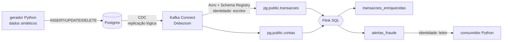

# Pipeline de pagamentos em tempo real: Postgres → CDC → Kafka → Flink SQL → alerta de fraude

Uma transação nasce no Postgres e, em poucos segundos, já está enriquecida com os dados da conta. Se o mesmo cartão fizer **3 transações em 60 segundos**, sai um alerta de fraude para quem consome.

Tudo roda em containers, com as mesmas peças da plataforma Confluent: Kafka, Schema Registry, Kafka Connect com Debezium e Apache Flink. O pipeline sobe com **um comando** no GitHub Codespaces, sem instalar nada e sem custo.



| Camada | O que faz | Arquivos |
|---|---|---|
| 1. Fundação | Kafka com 2 identidades (escritor e leitor) e permissões (ACLs) | `docker-compose.yml`, `scripts/kafka_init.sh` |
| 2. Contrato | Schema Registry com compatibilidade BACKWARD | `schemas/`, `scripts/testar_contrato.sh` |
| 3. Ingestão | CDC do Postgres com Debezium | `sql/postgres/`, `config/conector-postgres-cdc.json` |
| 4. Processamento | Flink SQL: enriquecimento + regra de fraude | `sql/flink/` |
| 5. Operação | Métricas, acessos e custo | Kafka UI, painel do Flink |

### Por que local e não no Confluent Cloud

O desafio sugere o Confluent Cloud, mas o cadastro exigia cartão de crédito. Montei o **mesmo caminho do dado** com as versões abertas e gratuitas das mesmas peças:

| No Confluent Cloud | Aqui |
|---|---|
| Cluster Kafka Basic | Kafka 7.7 (Confluent Platform) em modo KRaft |
| Service accounts + API keys | Usuários SASL `escritor` e `leitor` + ACLs |
| Schema Registry gerenciado | Schema Registry 7.7 (Confluent Platform) |
| Conector Postgres CDC Source V2 | Kafka Connect + Debezium, o mesmo motor de CDC |
| Flink SQL gerenciado | Apache Flink 1.19 SQL |
| Tela de métricas e billing | Kafka UI + painel do Flink; custo R$ 0 |

Os arquivos SQL e o raciocínio de cada camada se aplicam aos dois ambientes.

---

## 1. Fundação

**O que faz:** sobe o Kafka com controle de acesso ligado. Quem não tem permissão explícita é barrado. Existem duas identidades:

- **`escritor`**: só pode criar e escrever em tópicos que começam com `pg.`. É a identidade do conector de CDC.
- **`leitor`**: só pode **ler** `alertas_fraude` e `transacoes_enriquecidas`. É a identidade de quem consome os alertas.

Os serviços internos (Schema Registry, Flink e Kafka UI) usam uma porta que só existe dentro da rede do Docker.

**Por que assim:** é o princípio do menor privilégio. Se a senha do consumidor vazar, quem a pegar só consegue ler alertas. Não consegue injetar transações falsas nem ver os dados brutos do banco.

**Evidência** (`bash scripts/testar_acessos.sh`):

```
📸 COLE AQUI a saída completa do scripts/testar_acessos.sh
   (lista de permissões + TESTE 1 negado + TESTE 2 negado + TESTE 3 funcionando)
```

---

## 2. Contrato

**O que faz:** cada mensagem do Kafka é gravada em **Avro**, e o formato fica registrado no **Schema Registry**. O próprio conector registra os schemas das tabelas do banco. A regra é **BACKWARD**: uma versão nova só é aceita se quem já lê os dados continuar conseguindo ler.

O teste (`scripts/testar_contrato.sh`) tenta três versões de um schema de transação:

| Versão | Mudança | Resultado esperado |
|---|---|---|
| v1 | schema inicial | registrada |
| v2 | novo campo `canal`, opcional, com default | **compatível**, registrada |
| v3 | `valor` vira texto + campo obrigatório `moeda` sem default | **incompatível**, recusada com erro 409 |

**Por que:** sem contrato, uma mudança no banco pode quebrar silenciosamente quem consome lá na frente. Com ele, a quebra é barrada na entrada.

**Evidência** (`bash scripts/testar_contrato.sh`):

```
📸 COLE AQUI a saída do scripts/testar_contrato.sh
   ("is_compatible":true na v2, "is_compatible":false na v3, erro 409, versões [1,2])
```

📸 COLE AQUI: print do Kafka UI, aba **Schema Registry**, mostrando os subjects `pg.public.transacoes-value`, `alertas_fraude-value` etc.

---

## 3. Ingestão (CDC)

**O que faz:** o conector Debezium lê o log de replicação do Postgres (o WAL). Cada INSERT, UPDATE ou DELETE vira um evento no Kafka, com o "antes", o "depois" e o tipo de operação (`op`): `c` criado, `u` atualizado, `d` apagado, `r` carga inicial.

**O que o banco precisa antes do conector subir** (`sql/postgres/init/02_preparar_cdc.sql`):

1. `wal_level = logical`, ligado no `docker-compose.yml`;
2. um usuário com permissão de replicação;
3. uma **publication** dizendo quais tabelas entram;
4. `REPLICA IDENTITY FULL`, para o UPDATE e o DELETE trazerem a linha inteira de antes.

**Por que CDC e não batch:** um batch ("de hora em hora, copie as tabelas") chegaria tarde demais para barrar uma fraude. Ele também perde o que acontece entre duas cópias: um registro criado e apagado no meio some. O CDC entrega cada mudança, na ordem, segundos depois, lendo o log, sem fazer consultas pesadas no banco.

**Evidência** (`bash scripts/demo_cdc.sh`):

```
📸 COLE AQUI a saída do scripts/demo_cdc.sh
   (op=c, op=u com status aprovada -> estornada, op=d)
```

📸 COLE AQUI: print do Kafka UI, aba **Kafka Connect**, com o conector `cdc-postgres-pagamentos` em RUNNING

---

## 4. Processamento (Flink SQL)

**`sql/flink/00_tabelas.sql`**: declara as tabelas do Flink em cima dos tópicos:
- `transacoes_cdc`: lê o envelope do Debezium como **sequência de eventos**. A hora do evento é a hora da captura (`ts_ms`), com watermark de 5 s, ou seja, o Flink espera até 5 s por um evento atrasado;
- `contas`: lê com o formato `debezium-avro-confluent`, que entende insert, update e delete. Assim a tabela sempre mostra o estado atual de cada conta.

**`sql/flink/01_jobs.sql`**: dois jobs que ficam rodando sem parar:
1. **enriquecimento**: junta cada transação com a conta (titular, cidade, segmento e limite) e marca `valor_alto` quando o gasto passa de metade do limite. Grava em `transacoes_enriquecidas`;
2. **regra de fraude**: para cada transação, conta quantas o mesmo cartão fez nos **60 segundos anteriores**. Se forem 3 ou mais, grava em `alertas_fraude`.

**Por que essa janela:** usei uma janela **OVER** (deslizante), e não uma janela fixa (TUMBLE). A janela fixa corta o relógio em blocos de 1 minuto. Três compras às 00:50, 00:55 e 01:05 cairiam em blocos diferentes e passariam batido. A OVER olha para trás a partir de cada transação, então qualquer trio dentro de 60 s é pego.

**Evidência:** com o gerador rodando (`python gerador/gerar_dados.py`), a cada ~45 s ele dispara uma "RAJADA SUSPEITA" de 4 transações no mesmo cartão.

```
📸 COLE AQUI um trecho do terminal do gerador com a linha "--- RAJADA SUSPEITA no CARD-00XX ---"
```

```
📸 COLE AQUI a saída do python consumidor/ler_alertas.py
   com os alertas do MESMO cartão da rajada (3 e 4 transações em 60 s)
```

📸 COLE AQUI: resultado de `SELECT * FROM transacoes_enriquecidas;` no `bash scripts/flink_sql.sh`, com as colunas da conta preenchidas

📸 COLE AQUI: print do painel do Flink (porta 8082) com os jobs `enriquecimento` e `regra-fraude-3-em-60s` em RUNNING

---

## 5. Operação

📸 COLE AQUI: Kafka UI, aba **Topics**, com o número de mensagens de cada tópico

📸 COLE AQUI: Kafka UI, aba **Consumers**, com o grupo `leitor-alertas` e o lag (atraso) perto de zero

📸 COLE AQUI: Kafka UI, aba **ACL**, com as permissões do `escritor` e do `leitor`

📸 COLE AQUI: painel do Flink, dentro de um job, com *Records Received / Sent*

### Custo

| Item | Custo |
|---|---|
| Kafka, Schema Registry, Connect, Flink, Postgres | R$ 0 (software aberto, rodando em containers) |
| GitHub Codespaces | R$ 0, dentro da cota gratuita mensal da conta pessoal |
| **Total** | **R$ 0**. Usei ___ horas de Codespaces (📸 COLE AQUI) |

O consumo de horas aparece em *github.com → Settings → Billing and licensing*.

Para comparar: no Confluent Cloud, o mesmo pipeline seria cobrado por hora de conector, por CFU-minuto de Flink e por GB trafegado no cluster. Lá, o cuidado principal seria apagar o environment ao terminar.

---

## Como subir do zero

### Opção A: GitHub Codespaces (recomendado, nada para instalar)

1. Neste repositório, clique em **Code → Codespaces → ... → New with options**, escolha **4-core** e clique em **Create codespace**.
2. Espere abrir o editor (VS Code no navegador). No **terminal** de baixo, rode:
   ```bash
   bash scripts/subir.sh
   ```
   Na primeira vez ele baixa as imagens, o que leva de 5 a 10 minutos. No fim aparece **"Pipeline no ar!"**.
3. Abra um **segundo terminal** (ícone **+** do terminal) e gere transações:
   ```bash
   python gerador/gerar_dados.py
   ```
4. Abra um **terceiro terminal** e leia os alertas:
   ```bash
   python consumidor/ler_alertas.py
   ```
5. Para as evidências, rode `bash scripts/testar_acessos.sh`, `bash scripts/testar_contrato.sh` e `bash scripts/demo_cdc.sh`. Os painéis ficam na aba **PORTAS**: 8080 é o Kafka UI e 8082 é o painel do Flink.

### Opção B: no seu computador

Precisa de Docker (com 6 GB de memória livres) e Python 3.10+:

```bash
pip install -r requirements.txt
bash scripts/subir.sh
```

O resto é igual à opção A. Os painéis ficam em http://localhost:8080 e http://localhost:8082.

### Como derrubar tudo

```bash
bash scripts/derrubar.sh
```

O script apaga containers, dados e tópicos. O replication slot some junto com o banco. No Codespaces, depois pare a máquina: **menu ☰ → Codespaces → Stop Current Codespace**.

---

## Problemas que podem aparecer

| Sintoma | Causa provável | O que fazer |
|---|---|---|
| `subir.sh` fica muito tempo em "Esperando o Kafka Connect" | primeira subida, ainda baixando imagens | esperar; ver o andamento com `docker compose logs -f connect` |
| "O conector falhou" | banco ainda não pronto ou senha diferente | `docker compose logs connect \| tail -50`, depois rodar `subir.sh` de novo |
| Máquina lenta ou containers reiniciando | pouca memória | usar Codespace 4-core; ver uso com `docker stats` |
| Alertas não aparecem | o watermark só anda com eventos novos | deixar o gerador rodando: o alerta sai alguns segundos depois da rajada |
| Mudei a senha no `.env` e nada funciona | o banco guarda a senha da 1ª subida | `bash scripts/derrubar.sh` e depois `bash scripts/subir.sh` |

## Próximos passos

- Segunda regra de fraude: valor acima de 80% do limite em 5 minutos;
- Enviar eventos com defeito para uma fila separada (DLQ);
- Rodar o mesmo SQL no Confluent Cloud, trocando só os endereços.
