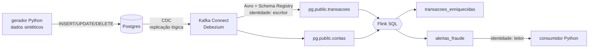
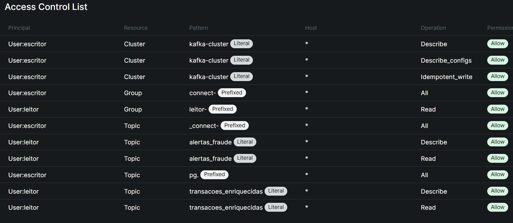
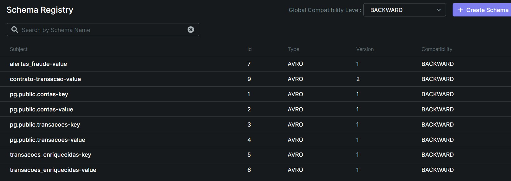
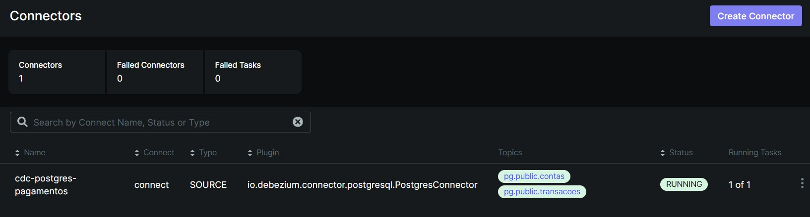
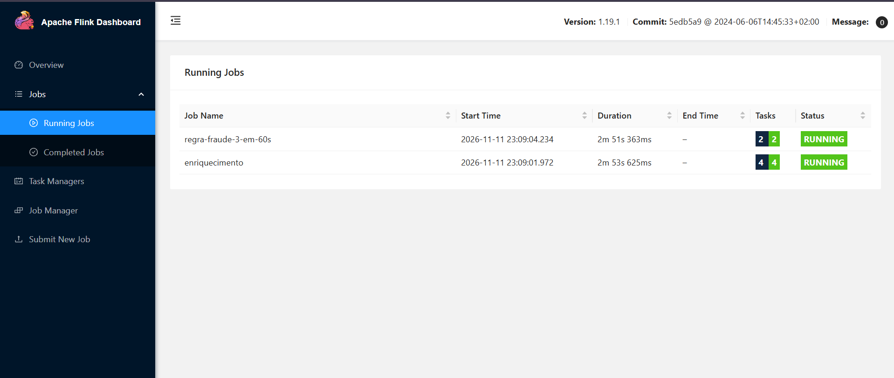
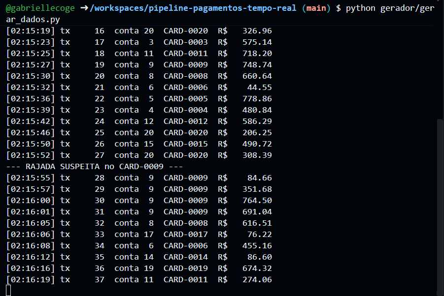
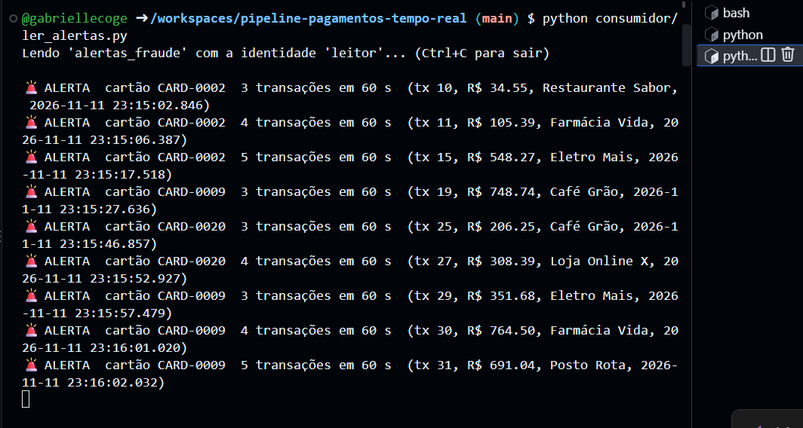
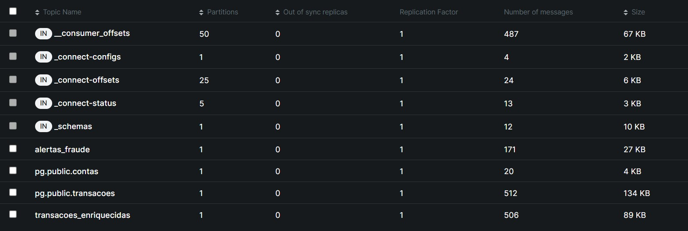
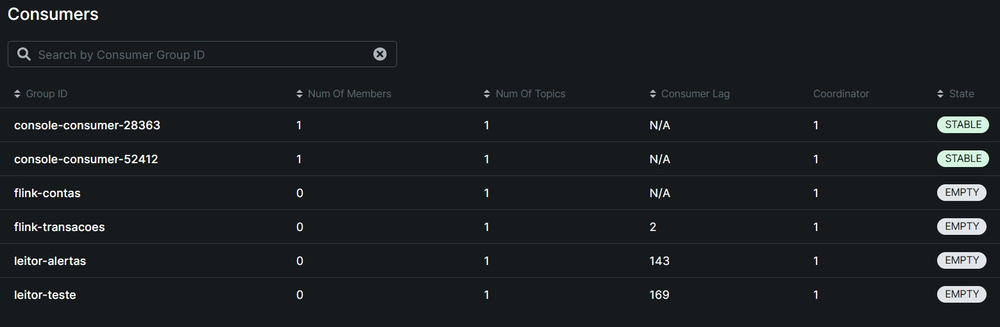

# Pipeline de pagamentos em tempo real: Postgres → CDC → Kafka → Flink SQL → alerta de fraude

Uma transação nasce no Postgres e, em poucos segundos, já está enriquecida com os dados da conta. Se o mesmo cartão fizer **3 transações em 60 segundos**, sai um alerta de fraude para quem consome.

Tudo roda em containers, com as mesmas peças da plataforma Confluent: Kafka, Schema Registry, Kafka Connect com Debezium e Apache Flink. O pipeline sobe com **um comando** no GitHub Codespaces, sem instalar nada e sem custo.



| Camada | O que faz | Arquivos | Evidência |
|---|---|---|---|
| 1. Fundação | Kafka com 2 identidades (escritor e leitor) e ACLs | `docker-compose.yml`, `scripts/kafka_init.sh` | [acessos](evidencias/01-acessos.txt) |
| 2. Contrato | Schema Registry com compatibilidade BACKWARD | `schemas/`, `scripts/testar_contrato.sh` | [contrato](evidencias/02-contrato.txt) |
| 3. Ingestão | CDC do Postgres com Debezium | `sql/postgres/`, `config/conector-postgres-cdc.json` | [eventos CDC](evidencias/03-cdc.txt) |
| 4. Processamento | Flink SQL: enriquecimento + regra de fraude | `sql/flink/` | [jobs](evidencias/04-flink-jobs.png), [alertas](evidencias/04-alertas.png) |
| 5. Operação | Métricas, acessos e custo | Kafka UI, painel do Flink | [tópicos](evidencias/05-topicos.jpg), [ACL](evidencias/05-acl.jpg) |

### Por que local e não no Confluent Cloud

O desafio sugere o Confluent Cloud, mas o cadastro exigia cartão de crédito. Montei o **mesmo caminho do dado** com as versões abertas e gratuitas das mesmas peças:

| No Confluent Cloud | Aqui |
|---|---|
| Cluster Kafka Basic | Kafka 7.7 (Confluent Platform) em modo KRaft |
| Service accounts + API keys | Usuários SASL `escritor` e `leitor` + ACLs |
| Schema Registry gerenciado | Schema Registry 7.7 (Confluent Platform) |
| Conector Postgres CDC Source V2 | Kafka Connect + Debezium, o mesmo motor de CDC |
| Flink SQL gerenciado | Apache Flink 1.19 SQL |
| Tela de métricas e billing | Kafka UI + painel do Flink; custo R$ 0 |

Os arquivos SQL e o raciocínio de cada camada se aplicam aos dois ambientes.

---

## 1. Fundação

**O que faz:** sobe o Kafka com controle de acesso ligado. Quem não tem permissão explícita é barrado. Existem duas identidades:

- **`escritor`**: só pode criar e escrever em tópicos que começam com `pg.`. É a identidade do conector de CDC.
- **`leitor`**: só pode **ler** `alertas_fraude` e `transacoes_enriquecidas`. É a identidade de quem consome os alertas.

Os serviços internos (Schema Registry, Flink e Kafka UI) usam uma porta que só existe dentro da rede do Docker.

**Por que assim:** é o princípio do menor privilégio. Se a senha do consumidor vazar, quem a pegar só consegue ler alertas. Não consegue injetar transações falsas nem ver os dados brutos do banco.

**Evidência:** `bash scripts/testar_acessos.sh` → saída completa em [`evidencias/01-acessos.txt`](evidencias/01-acessos.txt).

| Teste | Resultado |
|---|---|
| leitor tenta **escrever** em `alertas_fraude` | negado (`AuthorizationException`) |
| leitor tenta **ler** os dados brutos `pg.public.transacoes` | negado (`TopicAuthorizationException`) |
| leitor **lê** `alertas_fraude` | permitido (`Processed a total of 3 messages`) |

Permissões no Kafka UI:



---

## 2. Contrato

**O que faz:** cada mensagem do Kafka é gravada em **Avro**, e o formato fica registrado no **Schema Registry**. O próprio conector registra os schemas das tabelas do banco. A regra é **BACKWARD**: uma versão nova só é aceita se quem já lê os dados continuar conseguindo ler.

O teste (`scripts/testar_contrato.sh`) tenta três versões de um schema de transação:

| Versão | Mudança | Resultado |
|---|---|---|
| v1 | schema inicial | registrada |
| v2 | novo campo `canal`, opcional, com default | **compatível**, registrada |
| v3 | `valor` vira texto + campo obrigatório `moeda` sem default | **recusada com erro 409** |

**Por que:** sem contrato, uma mudança no banco pode quebrar silenciosamente quem consome lá na frente. Com ele, a quebra é barrada na entrada.

**Evidência:** saída completa em [`evidencias/02-contrato.txt`](evidencias/02-contrato.txt). Trecho da recusa da v3:

```
{"error_code":409,"message":"Schema being registered is incompatible with an earlier schema
 for subject \"contrato-transacao-value\", details: [{errorType:'TYPE_MISMATCH', ...
 additionalInfo:'reader type: STRING not compatible with writer type: DOUBLE'},
 {errorType:'READER_FIELD_MISSING_DEFAULT_VALUE', ... additionalInfo:'moeda'} ...
-> versões aceitas no subject:
[1,2]
```

Schemas registrados (o conector registrou os de `pg.public.*`, e o Flink os de saída):



---

## 3. Ingestão (CDC)

**O que faz:** o conector Debezium lê o log de replicação do Postgres (o WAL). Cada INSERT, UPDATE ou DELETE vira um evento no Kafka, com o "antes", o "depois" e o tipo de operação (`op`): `c` criado, `u` atualizado, `d` apagado, `r` carga inicial.

**O que o banco precisa antes do conector subir** (`sql/postgres/init/02_preparar_cdc.sql`):

1. `wal_level = logical`, ligado no `docker-compose.yml`;
2. um usuário com permissão de replicação;
3. uma **publication** dizendo quais tabelas entram;
4. `REPLICA IDENTITY FULL`, para o UPDATE e o DELETE trazerem a linha inteira de antes.

**Por que CDC e não batch:** um batch ("de hora em hora, copie as tabelas") chegaria tarde demais para barrar uma fraude. Ele também perde o que acontece entre duas cópias: um registro criado e apagado no meio some. O CDC entrega cada mudança, na ordem, segundos depois, lendo o log, sem fazer consultas pesadas no banco.

**Evidência:** `bash scripts/demo_cdc.sh` faz um INSERT, um UPDATE e um DELETE no banco e mostra os 3 eventos lidos do Kafka. Saída completa em [`evidencias/03-cdc.txt`](evidencias/03-cdc.txt). Trecho:

```
op=c  status antes=None  status depois=aprovada
op=u  status antes=aprovada  status depois=estornada
   evento: {"op": "u", "before": {... "id_transacao": 432, "id_cartao": "CARD-DEMO",
            "status": "aprovada" ...}, "after": {... "status": "estornada" ...}}
op=d  status antes=estornada  status depois=None
   evento: {"op": "d", "before": {... "status": "estornada" ...}, "after": null}
```

Conector rodando:



---

## 4. Processamento (Flink SQL)

**`sql/flink/00_tabelas.sql`**: declara as tabelas do Flink em cima dos tópicos:
- `transacoes_cdc`: lê o envelope do Debezium como **sequência de eventos**. A hora do evento é a hora da captura (`ts_ms`), com watermark de 5 s, ou seja, o Flink espera até 5 s por um evento atrasado;
- `contas`: lê com o formato `debezium-avro-confluent`, que entende insert, update e delete. Assim a tabela sempre mostra o estado atual de cada conta.

**`sql/flink/01_jobs.sql`**: dois jobs que ficam rodando sem parar:
1. **enriquecimento**: junta cada transação com a conta (titular, cidade, segmento e limite) e marca `valor_alto` quando o gasto passa de metade do limite. Grava em `transacoes_enriquecidas`;
2. **regra de fraude**: para cada transação, conta quantas o mesmo cartão fez nos **60 segundos anteriores**. Se forem 3 ou mais, grava em `alertas_fraude`.

**Por que essa janela:** usei uma janela **OVER** (deslizante), e não uma janela fixa (TUMBLE). A janela fixa corta o relógio em blocos de 1 minuto. Três compras às 00:50, 00:55 e 01:05 cairiam em blocos diferentes e passariam batido. A OVER olha para trás a partir de cada transação, então qualquer trio dentro de 60 s é pego.

**Evidência:** os dois jobs rodando no Flink:



O gerador (`python gerador/gerar_dados.py`) dispara, a cada ~45 s, uma rajada de 4 transações no mesmo cartão. Aqui, no `CARD-0009`, com as transações 28 a 31:



O consumidor (`python consumidor/ler_alertas.py`, identidade `leitor`) recebe os alertas do mesmo cartão:



**O que observei:**
- **Falsos positivos.** Os cartões `CARD-0002` e `CARD-0020` também geraram alerta sem rajada, porque fizeram 3 compras em menos de 60 s por acaso. A regra está correta, mas uma regra só de frequência é ingênua. Uma segunda regra (valor × limite) ou um modelo de risco reduziria isso.
- **Fuso horário.** O gerador imprime a hora da máquina em UTC, e o Flink está configurado para `America/Sao_Paulo`. Os horários diferem em 3 h, mas são o mesmo instante.

---

## 5. Operação

Tópicos e volume de mensagens:



Grupo de consumo `leitor-alertas` e o atraso (lag):



As permissões (ACLs) aparecem na camada 1.

### Custo

| Item | Custo |
|---|---|
| Kafka, Schema Registry, Connect, Flink, Postgres | R$ 0 (software aberto, rodando em containers) |
| GitHub Codespaces (máquina 4-core) | R$ 0, dentro da cota gratuita mensal da conta pessoal |
| **Total** | **R$ 0**, em cerca de 1h30 de Codespaces |

O consumo de horas aparece em *github.com → Settings → Billing and licensing*.

Para comparar: no Confluent Cloud, o mesmo pipeline seria cobrado por hora de conector, por CFU-minuto de Flink e por GB trafegado no cluster. Lá, o cuidado principal seria apagar o environment ao terminar.

---

## Como subir do zero

### Opção A: GitHub Codespaces (recomendado, nada para instalar)

1. Neste repositório, clique em **Code → Codespaces → ... → New with options**, escolha **4-core** e clique em **Create codespace**.
2. Quando o editor abrir, no **terminal** de baixo rode:
   ```bash
   pip install -r requirements.txt
   bash scripts/subir.sh
   ```
   Na primeira vez leva de 5 a 10 minutos. No fim aparece **"Pipeline no ar!"**.
3. Em um **segundo terminal** (botão **+**), gere transações:
   ```bash
   python gerador/gerar_dados.py
   ```
4. Em um **terceiro terminal**, leia os alertas:
   ```bash
   python consumidor/ler_alertas.py
   ```
5. Evidências: `bash scripts/testar_acessos.sh`, `bash scripts/testar_contrato.sh` e `bash scripts/demo_cdc.sh`. Os painéis ficam na aba **Portas**: 8080 é o Kafka UI e 8082 é o painel do Flink.

O gerador e o consumidor rodam sem parar, como um sistema real. Para parar, use **Ctrl + C**.

### Opção B: no seu computador

Precisa de Docker (com 6 GB de memória livres) e Python 3.10+:

```bash
pip install -r requirements.txt
bash scripts/subir.sh
```

O resto é igual à opção A. Os painéis ficam em http://localhost:8080 e http://localhost:8082.

### Como derrubar tudo

```bash
bash scripts/derrubar.sh
```

O script apaga containers, dados e tópicos. O replication slot some junto com o banco. No Codespaces, depois pare a máquina: **menu ☰ → Codespaces → Stop Current Codespace**.

---

## Problemas que encontrei (e como resolvi)

| Problema | Causa | Solução |
|---|---|---|
| Confluent Cloud pedia cartão | política de cadastro | mesmas peças em containers, no Codespaces |
| Codespace entrou em *recovery mode* | configuração `.devcontainer` própria falhou | removi o `.devcontainer`; a imagem padrão do Codespaces já tem Docker e Python |
| `demo_cdc.sh` não terminava | a leitura esperava 15 s sem mensagens, e o gerador nunca parava | o script consulta quantas mensagens existem e lê exatamente essa quantidade |
| Teste de escrita do leitor dava erro de *cluster*, não de *tópico* | o produtor tenta usar escrita idempotente, que exige outra permissão | desliguei a idempotência só no teste |

## Próximos passos

- Segunda regra de fraude: valor acima de 80% do limite em 5 minutos;
- Enviar eventos com defeito para uma fila separada (DLQ);
- Rodar o mesmo SQL no Confluent Cloud, trocando só os endereços.
